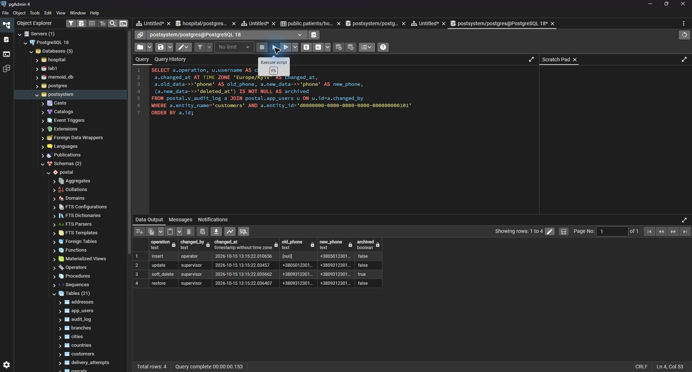
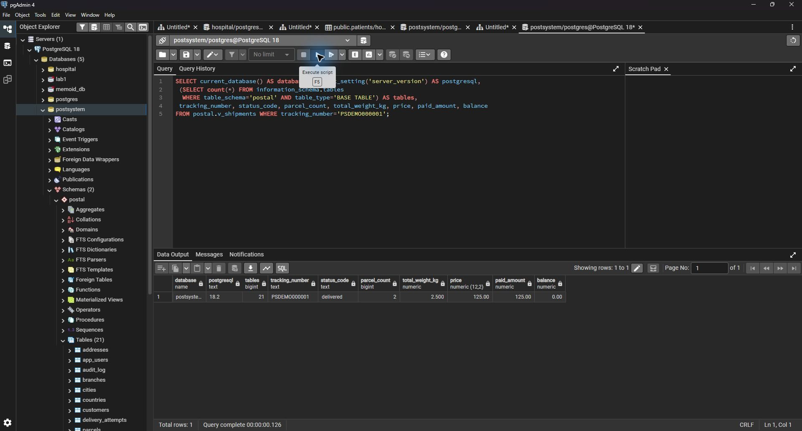
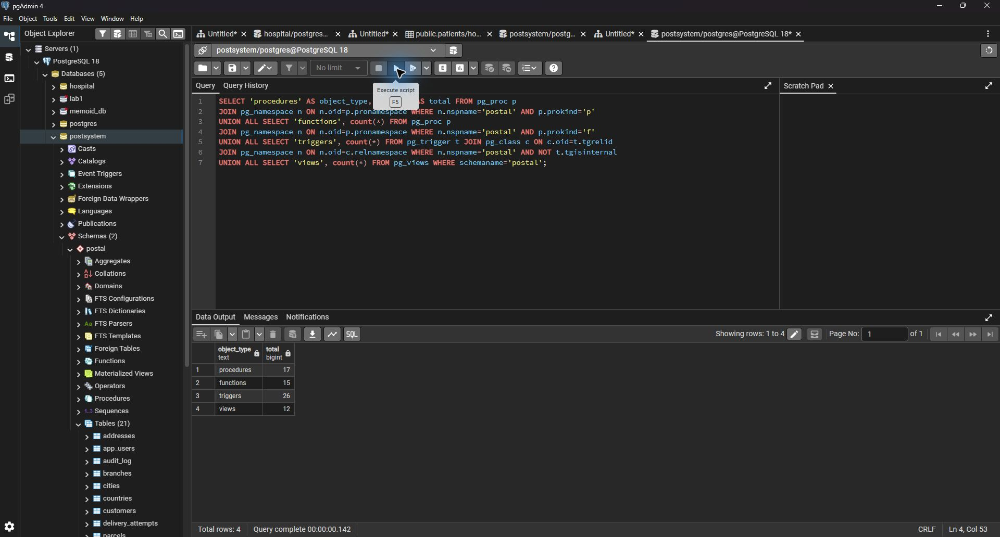
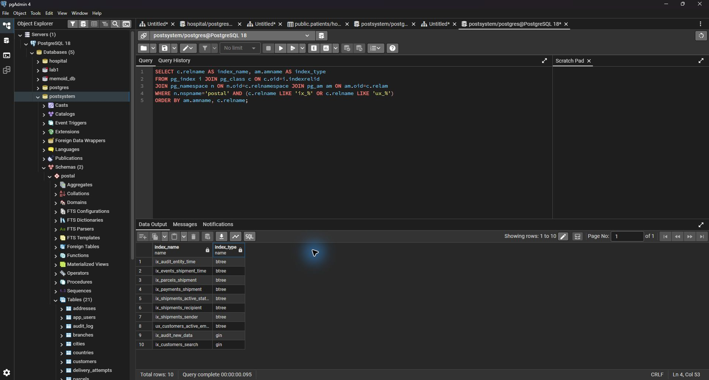
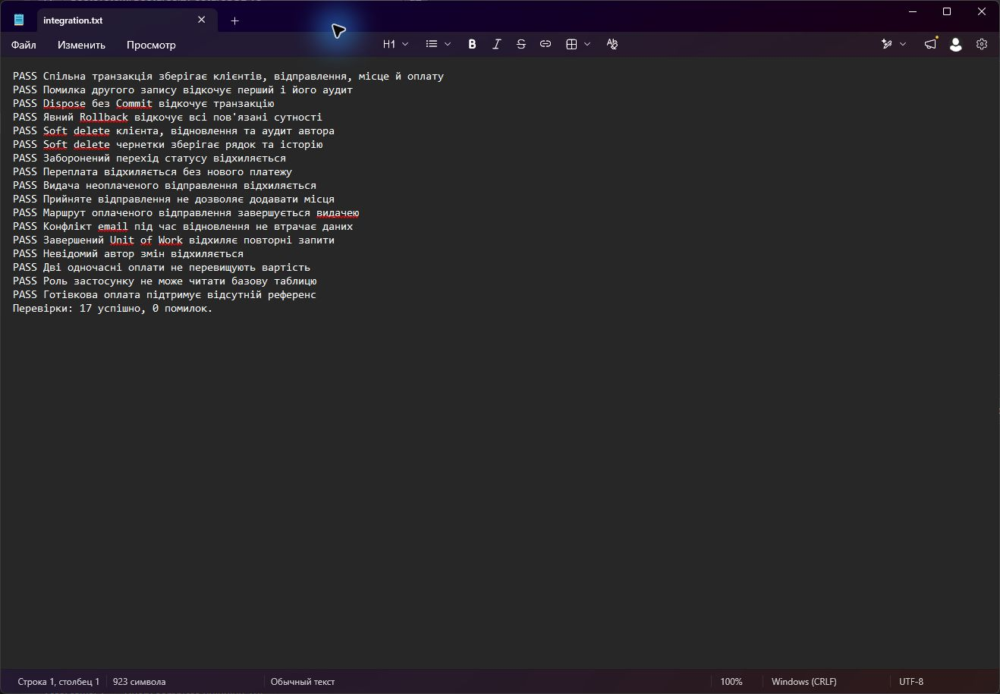

# Система управління поштовими відправленнями

PostgreSQL 18, C# / .NET 10. Облік клієнтів, посилок, відстеження, перевезень та оплати. Нижче наведено матеріали для перевірки семи пунктів завдання.

1 стадія. Схема БД

[ER-схема в GitHub](docs/design/er.md) містить таблиці, поля, типи, ключі та зв’язки. [Файл drawio](docs/design/postsystem.drawio) має повну модель і окремі сторінки відправлень, довідників, перевезень та аудиту.

2 стадія. Сутності

У [каталозі сутностей](docs/entities.md) описано 20 предметних таблиць і технічний журнал `audit_log`, разом 21. Для кожної вказано призначення, поля й ключі. Кількість таблиць у встановленій БД видно на знімку в пункті 4.

3 стадія. Вимоги, soft delete та аудит

[Вимоги R01-R18](docs/requirements.md) пов’язані із сутностями. У `customers`, `addresses`, `branches`, `shipments` є час і автор зміни та архівування. На знімку видно створення, зміну, архівування й відновлення клієнта двома працівниками. [Окремий знімок soft delete](docs/evidence/06-soft-delete.jpg) показує: запис збережено, в активному представленні його немає.

4 стадія. Реалізація у PostgreSQL

База `postsystem` встановлена на PostgreSQL 18. У схемі `postal` створено 21 таблицю. Приклад `PSDEMO000001` містить два пакунки загальною вагою 2,5 кг; вартість і оплата становлять 125 грн, статус `delivered`.

5 стадія. Процедури, функції, тригери та View

Створено 17 процедур, 15 функцій, 26 тригерів і 12 представлень. Вони забезпечують роботу з відправленнями, оплатами, soft delete та аудитом. Реалізація міститься у [SQL-файлі](db/003_logic.sql).

6 стадія. Індекси

Використано два методи індексування: B-tree для ключів, станів та історії; GIN для пошуку клієнтів і даних JSONB. На знімку наведено назви й типи індексів. [SQL створення](db/004_indexes.sql).

7 стадія. Repository + Unit of Work

[Репозиторії](src/PostSystem.Data/Repositories.cs) працюють зі спільною транзакцією [Unit of Work](src/PostSystem.Data/PostalUnitOfWork.cs): читають представлення та викликають процедури для змін. [Приклад реєстрації](src/PostSystem.Data/ShipmentService.cs) зберігає клієнтів, відправлення, пакунок і оплату одним commit.

Пройдено 17 інтеграційних перевірок, зокрема спільний commit, відкат після помилки, soft delete, аудит і дві одночасні оплати. Пряме читання таблиць прикладною роллю заборонено. [Успішний запуск GitHub Actions](https://github.com/quadroex/postsystem/actions/runs/38719289861) містить повний журнал збірки та перевірок.

[Результати перевірки від 15.10.2026](docs/verification.md). [Технічний додаток: встановлення та запуск](docs/setup.md).
