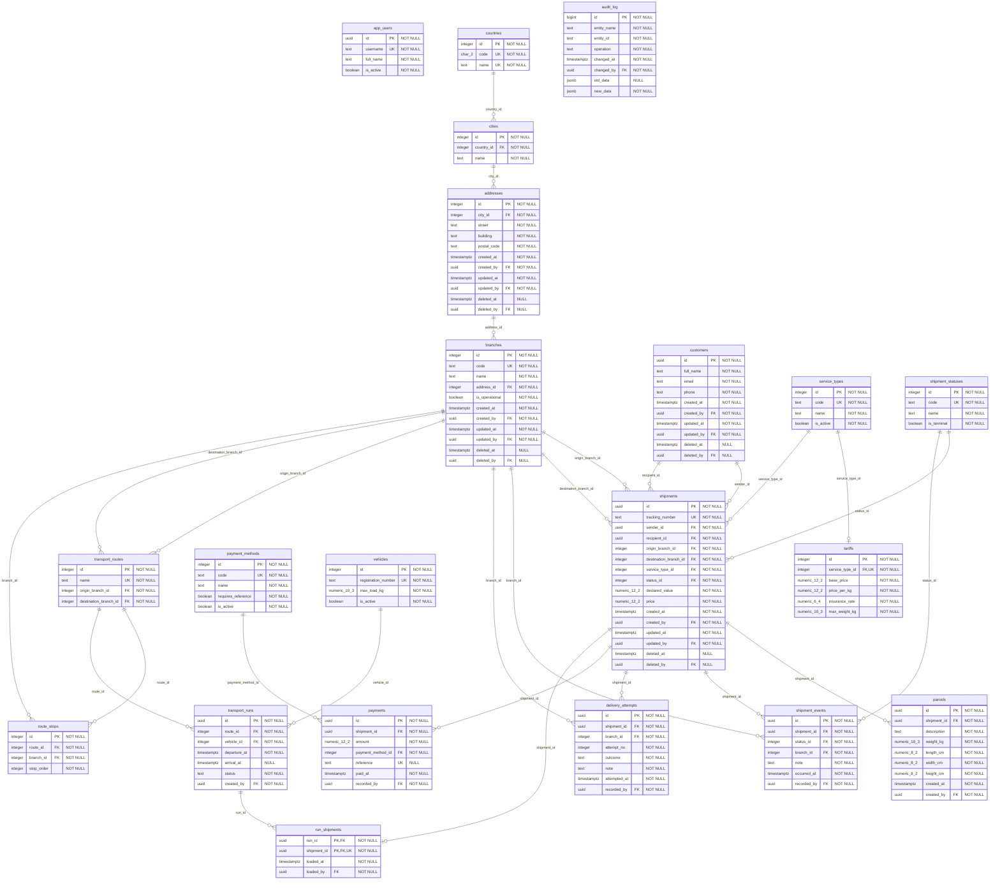

# Схема бази даних

Діаграма містить 20 предметних сутностей і технічну таблицю `audit_log`.

У [postsystem.drawio](postsystem.drawio) є повна модель та сторінки відправлень, довідників, перевезень і аудиту. Файл відкривається через **File → Open from → Device** у diagrams.net. [schema.dbml](schema.dbml) можна імпортувати в dbdiagram.io.

`PK` — первинний ключ, `FK` — зовнішній, `UK` — унікальний. `o{` означає 0..N, `||` — 1, `o|` — 0..1. Усі `*_by` посилаються на `app_users.id`; ці зв’язки окремо показано на сторінці «Аудит» у drawio.

Точні типи PostgreSQL, обмеження `CHECK`, значення за замовчуванням і дії зовнішніх ключів задано в [`db/001_schema.sql`](../../db/001_schema.sql).
